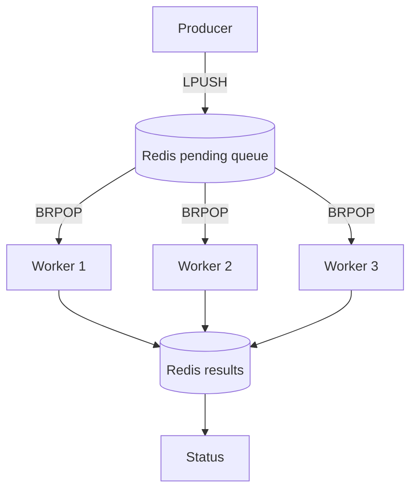

# Distributed Workers Lab

A small Docker Compose lab for exploring task queues, worker replicas, and horizontal scaling. Python workers consume jobs from Redis and calculate squares. No Hadoop or MapReduce is involved yet.

## Requirements

- Docker Engine or Docker Desktop
- Docker Compose v2 (`docker compose`)

No local Python or Redis installation is needed.

## Architecture



Redis is the shared queue. Every worker independently asks Redis for a job. `BRPOP` removes a job atomically, so two workers do not receive the same queued item. Workers save completed results in a Redis hash. The producer and status commands run as temporary containers.

## 1. Start with one worker

From this directory:

```bash
docker compose up -d --build --scale worker=1 redis worker
docker compose ps
```

Check the worker output:

```bash
docker compose logs -f worker
```

Keep this terminal open, or use `Ctrl+C` to stop following the logs without stopping the container.

## 2. Send the first batch

In a second terminal:

```bash
docker compose run --rm producer python -u app/producer.py --count 12
```

Watch the worker logs. Each task calculates the square of a number and takes approximately two seconds. With one worker, twelve tasks take roughly 24 seconds plus overhead.

Check results:

```bash
docker compose run --rm status
```

## 3. Scale to three workers

```bash
docker compose up -d --scale worker=3 worker
docker compose ps
docker compose run --rm producer python -u app/producer.py --count 12
docker compose logs -f worker
```

In another terminal:

```bash
docker compose run --rm status
```

Compare how tasks are shared among workers. A fresh twelve-task batch should take roughly eight seconds if all three workers are ready, though timing and distribution can vary. `status` displays cumulative results from all batches, not only the latest batch.

## 4. Inspect Redis

```bash
docker compose exec redis redis-cli LLEN tasks:pending
docker compose exec redis redis-cli HLEN tasks:results
docker compose exec redis redis-cli LRANGE tasks:pending 0 -1
```

The pending count may be zero after workers finish. Run the commands immediately after publishing a larger batch to see queued work.

## 5. Observe a worker failure

Start a longer batch:

```bash
docker compose run --rm producer python -u app/producer.py --count 30
```

Find a worker container:

```bash
docker compose ps -q worker
```

Stop one of the listed container IDs while jobs are running:

```bash
docker stop <container-id>
```

Then inspect the remaining workers:

```bash
docker compose logs --tail=50 worker
docker compose run --rm status
```

**Expected limitation:** this example uses `BRPOP`, which removes a task before processing. If a worker dies after claiming a task but before saving the result, that task is lost. Other queued tasks can still be processed. This is intentional: it gives the class a concrete reliability problem to discuss.

Restore the desired number of workers:

```bash
docker compose up -d --scale worker=3 worker
```

## 6. Reset and clean up

To stop containers but keep Redis data:

```bash
docker compose down
```

To remove containers and the Redis volume, resetting pending tasks and results:

```bash
docker compose down -v
```

Run `docker compose down -v` before each timed comparison if you want clean result counts.

## Discussion

1. What changed when we scaled from one worker to three?
2. Why does Redis deliver a queued task to only one worker?
3. What happens to a task when a worker stops halfway through processing?
4. What if Redis itself becomes unavailable?
5. Is this a distributed system even though every container runs on one laptop?
6. How could we redesign the queue to retry unfinished tasks?

## What comes next?

This lab distributes independent jobs. MapReduce adds a data-processing pattern: partition the input, map records to intermediate key/value pairs, shuffle by key, and reduce each group. We will build that pattern separately in the next exercise.

## Notes

- The demo uses `time.sleep` to make task distribution visible. It is not a CPU benchmark.
- Redis is not exposed to the host. All containers communicate over the Compose network.
- Results are retained between batches until the Redis volume is removed.
- This is a teaching example, not a production-ready task queue. It has no acknowledgment, retry, dead-letter queue, or exactly-once processing guarantees.
